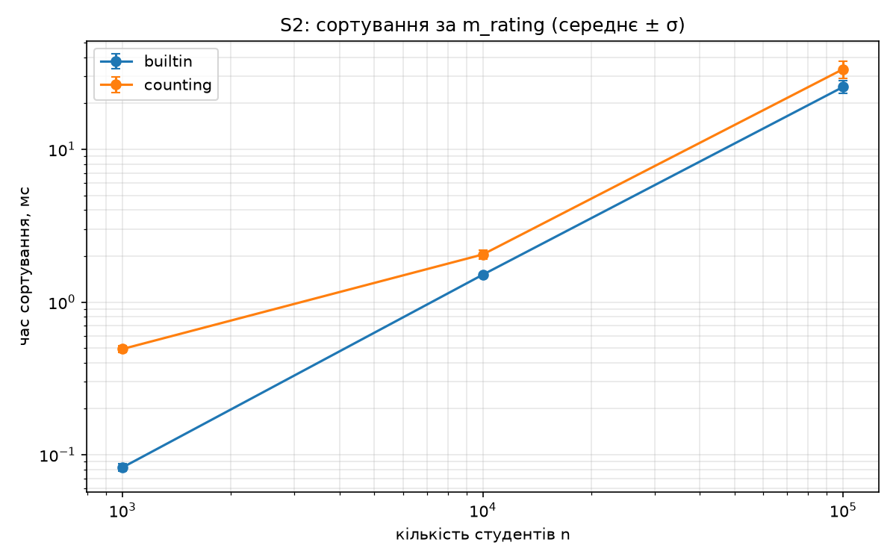

# Домашнє завдання №1. Сортування і структури даних

**Автор:** Мархевка Олександр
**Мова:** Python 3.10+ (використовуються підказки типів `list[str]`)
**Варіанти:** задача I, варіант **V5**; задача II, варіант **S2**

| Задача | Що потрібно зробити | Де код |
|---|---|---|
| I (V5) | База студентів у пам'яті; операції: топ-100 за рейтингом, встановлення рейтингу за email, група(и) з найбільшим середнім рейтингом; три різні структури даних, експерименти, регресія | `data_structures/` |
| II (S2) | Сортування студентів за `m_rating` і збереження в CSV; стандартне сортування проти власного алгоритму | `sorting/` |

## Зміст

1. Загальна інформація
2. Структура репозиторію
3. Підготовка до запуску
4. Як запускати
5. Умова завдання (`task.md`)
6. Задача I: обґрунтування вибору структур (`rationale.md`)
7. Задача I: методика експериментів (`data_structures/benchmark/experiments_notes.md`)
8. Задача I: результати експериментів
9. Задача II: реалізація і методика (`sorting/notes_sort.md`)
10. Задача II: результати

---

## 1. Загальна інформація

Проєкт складається з двох незалежних частин.

**Задача I.** Потрібно зберігати базу студентів у пам'яті й виконувати три операції у співвідношенні 50 : 1 : 10:

1. повернути 100 студентів з найвищим рейтингом;
2. встановити рейтинг студенту за `m_email`;
3. знайти групу або групи з найбільшим середнім рейтингом.

Метрика: кількість операцій за 10 секунд. Реалізовано три варіанти з різними контейнерами:

| Варіант | Файл | Ідея |
|---|---|---|
| 1 | `hash_scan.py` | список + хеш-таблиця; топ-100 через `heapq.nlargest` (базовий) |
| 2 | `sorted_array.py` | відсортований масив пар `(рейтинг, email)` + бінарний пошук |
| 3 | `buckets_heap.py` | хеш-кошики за рейтингом + ліниве max-купа середніх по групах |

Найкращим за експериментом виявився **варіант 3** (≈ 484 000 операцій за 10 с проти ≈ 293 000 у варіанта 2 і ≈ 2 700 у варіанта 1). Для нього виконано дослідження залежності часу і пам'яті від розміру бази та регресію.

**Задача II.** Сортування за `m_rating` за зростанням із записом у CSV. Дві реалізації: стандартний `sorted` і власне сортування підрахунком (counting sort). Час побудови допоміжних структур входить у час сортування, запис у файл не входить.

**Спільні для обох задач ідеї:**

- рейтинг має не більше двох знаків після коми, тому його зручно зберігати і порівнювати в цілих сотих (`round(rating * 100)`);
- для всіх вимірювань використовуються заздалегідь згенеровані дані з фіксованим seed і нові копії об'єктів на кожен запуск.

---

## 2. Структура репозиторію

```
.
├── README.md                          ← цей файл
├── task.md                            ← умова завдання
├── rationale.md                       ← обґрунтування структур, DoS (задача I)
├── .gitignore                         ← students.csv, __pycache__
├── data_structures/                   ← задача I
│   ├── hash_scan.py                   ← варіант 1
│   ├── sorted_array.py                ← варіант 2
│   ├── buckets_heap.py                ← варіант 3
│   ├── DS_tests.py                    ← тести коректності
│   ├── database/
│   │   ├── student.py                 ← dataclass Student
│   │   ├── loader.py                  ← читання students.csv
│   │   └── students.csv               ← база (не в git)
│   └── benchmark/
│       ├── benchmark.py               ← compare / scaling
│       ├── analyze.py                 ← таблиця, регресія, графіки
│       ├── experiments_notes.md       ← методика експериментів
│       ├── regression_manual.md       ← ручний розрахунок регресії
│       ├── results_compare.csv        ← операцій за 10 с
│       ├── results_scaling_v3.csv     ← сирі виміри для варіанта 3
│       ├── summary.csv                ← таблиця: середнє і σ
│       ├── regression.txt             ← коефіцієнти і R²
│       ├── fit.png                    ← графік регресії
│       └── memory.png                 ← графік пам'яті
└── sorting/                           ← задача II
    ├── sorters.py                     ← sort_builtin, sort_counting
    ├── sort_students.py               ← сортування + запис у CSV
    ├── SORT_tests.py                  ← тести коректності
    ├── benchmark_sort.py              ← експеримент за розмірами
    ├── notes_sort.md                  ← методика задачі II
    ├── results_sort.csv               ← сирі виміри (після запуску)
    ├── summary_sort.csv               ← середнє і σ (після запуску)
    └── sort_time.png                  ← графік (після запуску)
```

---

## 3. Підготовка до запуску

**1. Python.** Версія 3.10 або новіша.

**2. Пакети.** Для тестів і вимірювань задачі I та II нічого додатково ставити не потрібно (лише стандартна бібліотека). Для побудови графіків і регресії потрібні `numpy` і `matplotlib`:

```
pip install numpy matplotlib
```

Без `matplotlib` `benchmark_sort.py` усе одно працює, лише пропускає графік. `analyze.py` без `numpy` і `matplotlib` не запуститься.

**3. Файл `students.csv`.** У репозиторії його немає (див. `.gitignore`). Покладіть його в

```
data_structures/database/students.csv
```

Саме там його шукає `loader.py` за замовчуванням (шлях рахується від розташування `loader.py`). Заголовок файлу:

```
m_name,m_surname,m_email,m_birth_year,m_birth_month,m_birth_day,m_group,m_rating,m_phone_number
```

Іншу назву або абсолютний шлях можна вказати параметром `--csv`.

**4. Усі команди** виконуються з **кореня репозиторію** (це важливо для імпортів виду `data_structures.…` і `sorting.…`). У прикладах використано `py` (Windows); на Linux/macOS замініть на `python3`.

---

## 4. Як запускати

### 4.1. Задача I

```
py -m data_structures.DS_tests
```
Перевірка коректності всіх трьох варіантів проти повільного, але очевидно правильного еталона (точні середні через `Fraction`). Включає перевірку внутрішніх інваріантів після змін.

```
py -m data_structures.benchmark.benchmark compare
```
Кількість операцій за 10 с для трьох варіантів, 3 запуски на варіант. Пише `results_compare.csv`.

```
py -m data_structures.benchmark.benchmark scaling
```
Час операцій 1, 2, 3 і пам'ять для 10 розмірів бази (100 … 100 000), по 5 запусків. За замовчуванням береться найкращий варіант із `results_compare.csv`. Пише `results_scaling_v<N>.csv`. Інші параметри:

```
py -m data_structures.benchmark.benchmark scaling --variant 1     # конкретний варіант
py -m data_structures.benchmark.benchmark compare --seconds 2     # коротший тест
```

```
py -m data_structures.benchmark.analyze
```
Таблиця `summary.csv`, регресія `regression.txt`, графіки `fit.png`, `memory.png`. Власний базис: `--basis "n,log n,1"`. Якщо файлів `results_scaling_v*.csv` кілька, вкажіть `--file results_scaling_v3.csv`.

**Порядок повного прогону:** `DS_tests` → `compare` → `scaling` → `analyze`.

### 4.2. Задача II

```
py -m sorting.SORT_tests
```
Перевірка обох сортувань (порожній список, дублікати, межі 0 і 100, відсортований і зворотний порядок, некоректні рейтинги, round-trip через CSV).

```
py -m sorting.benchmark_sort
```
Порівняння часу `sorted` і counting sort для 10 розмірів, 5 повторів. Пише `results_sort.csv`, `summary_sort.csv`, `sort_time.png`. Параметри: `--reps 10`, `--sizes 1000 10000 100000`, `--min-time 0.05`.

```
py -m sorting.sort_students --method counting --out sorted_by_rating.csv
```
Відсортувати базу й зберегти в CSV. `--method` приймає `builtin` або `counting`.

---

## 5. Умова завдання

*(повторює `task.md`; задача I — варіант V5, задача II — варіант S2)*

### 5.1. Суть задачі

Необхідно реалізувати структуру даних, яка буде зберігати базу студентів у пам'яті і виконувати наступні операції:

1. Повернути 100 студентів з найвищим рейтингом.
2. Встановити рейтинг студенту за його електронною поштою (`m_email`).
3. Знайти групу або групи з найбільшим середнім рейтингом студентів.

оптимальним чином, щоб досягти найбільшої кількості операцій, виконаних за 10 секунд.

Співвідношення кількості операцій визначається наступним чином: 50 : 1 : 10. Операції мають надходити у випадковому порядку і використовувати існуючі значення полів там, де це можливо. Операції необхідно підготувати наперед, щоб вони не впливали на повторення експериментів.

Структура даних може суміщати різні контейнери для розв'язання задачі оптимальним чином. Наприклад: хеш-таблиця за полем `m_group`, BST за полем `m_surname`, посортований статичний масив за полем `m_birth_year`.

### 5.2. Структура бази даних

База даних містить такі поля. Її необхідно зчитати в пам'ять з файлу `students.csv`.

```py
from dataclasses import dataclass

@dataclass
class Student:
    m_name: str           # Name in Ukrainian
    m_surname: str        # Surname in Ukrainian
    m_email: str          # [a-z.]*@student.org is unique
    m_birth_year: int     # 1950..2010
    m_birth_month: int    # 1..12
    m_birth_day: int      # 1..Number of days in m_birth_month
    m_group: str          # [A-Z][A-Z][A-Z]-[0-9][0-9]
    m_rating: float       # 0..100
    m_phone_number: str   # 38(0xx)xx-xx-xxx is unique
```

### 5.3. Задача I — ініціалізація і виконання операцій

Програма має підтримувати такі операції:

- **Ініціалізація:** створення бази в пам'яті з непосортованого файлу на диску у форматі CSV (`students.csv`).
- **Операції 1, 2, 3:**
  1. Повернути 100 студентів з найвищим рейтингом.
  2. Встановити рейтинг студенту за його електронною поштою (`m_email`).
  3. Знайти групу або групи з найбільшим середнім рейтингом студентів.

### 5.4. Задача II — сортування

Операція сортування визначається варіантом. Сортування або за зростанням, або в алфавітному порядку. Сортування має враховувати українську абетку там, де це важливо. Порядок записів з однаковим значенням ключа не визначається. Час побудови всіх допоміжних структур даних входить у час сортування.

- **S2.** Посортувати всіх студентів за `m_rating` і зберегти в CSV-файл.

### 5.5. Очікуваний результат й експерименти до задачі I

- Програма мовою Python.
- Потрібно реалізувати 3 різні варіанти вирішення задачі I з використанням різних контейнерів на Python. Для кожного запропонованого варіанту необхідно експериментально порахувати кількість виконаних операцій за 10 секунд. Операції 1, 2, 3 повинні випадковим чином обиратися у співвідношенні 50 : 1 : 10.
- Для найкращого варіанта з попереднього пункту необхідно виконати експеримент для 10 різних розмірів початкової бази даних від 100 до 100000 (проміжні значення і кількість експериментів ≥ 5 на одну точку треба обрати самостійно). Також необхідно порахувати об'єм використаної пам'яті і середній час виконання кожної з операцій 1, 2, 3. Методику оцінки використаної пам'яті обрати та обґрунтувати самостійно.
- Оцінити за допомогою лінійної регресії, як зростає час виконання найповільнішої з операцій 1, 2, 3 зі зростанням кількості записів в базі даних. Оцінка має бути отримана у вигляді функції:

  T(n) = c₁·f₁(n) + c₂·f₂(n) + c₃·f₃(n)

  де функції f₁, f₂, f₃ необхідно підібрати відповідно до теоретичної оцінки складності складових алгоритму (наприклад, f₁ = n², f₂ = n log n, f₃ = n), а коефіцієнти c₁, c₂, c₃ отримати методом лінійної регресії. Отримані результати і функцію T(n) необхідно подати таблично та зобразити на графіку, де для кожної експериментально отриманої точки треба відобразити середнє і середньоквадратичне відхилення.

**На захисті необхідно показати:**

- що обраний вами варіант реалізації є раціональним;
- що всі операції виконуються правильно;
- що коректність зберігається після виконання операцій зміни даних;
- що експерименти виконано правильно;
- як зміниться вибір структур даних, якщо система має бути стійка до DoS атаки (базу і запити формує ненадійний користувач)?

### 5.6. Очікувані результати задачі II

Для задачі II необхідно зробити дві реалізації та порівняти час сортування. Час запису результату у файл при вимірюванні часу сортування не враховується.

Необхідно реалізувати:

1. Сортування з використанням стандартної функції сортування обраної мови програмування.
2. Власну реалізацію алгоритму сортування з використанням Radix Sort, BST чи іншого підходу, який може пришвидшити сортування.

Після реалізації необхідно експериментально порівняти час роботи обох підходів в залежності від кількості записів в базі даних.

---

## 6. Обґрунтування вибору структур даних (задача I)

*(повторює `rationale.md`)*

### 6.1. Умови

Операції:

1. топ-100 за `m_rating`;
2. встановлення `m_rating` за `m_email`;
3. група (групи) з найбільшим середнім `m_rating`.

Співвідношення частот 50 : 1 : 10, тобто частки 82 %, 2 %, 16 % відповідно. Метрика: кількість операцій за 10 с.

Позначення: `n` — кількість студентів, `G` — кількість груп, `K = 100`. Пошукові ключі `m_email` унікальні (за умовою завдання).

### 6.2. Спільні компоненти (усі варіанти)

**6.2.1. Хеш-таблиця `by_email`:** `m_email` → `Student`. Пошук студента в операції 2 виконується за O(1) у середньому замість O(n).

**6.2.2. Статистика груп `group_stats`:** `m_group` → `[сума, кількість]`. Сума зберігається в цілих сотих (`round(rating * 100)`). Операція 2 змінює суму на різницю нового й старого значень, кількість не змінюється. Це дає O(1) на оновлення середнього групи й точне (без похибки float) порівняння середніх груп.

**6.2.3. Умова точності.** Середні порівнюються як `float(сума / кількість)`. Для n ≤ 10⁵ різні дроби a/b та c/d (b, d ≤ n) відрізняються щонайменше на 1/(b·d) ≥ 10⁻¹⁰. Це більше за відстань між сусідніми числами float на інтервалі [0, 10⁴] (приблизно 1,8·10⁻¹²). Рівні дроби дають однакове float. Отже, рівність середніх, а з нею й нічия між групами, визначається правильно.

### 6.3. Варіанти

#### 6.3.1. Варіант 1: список + хеш-таблиця (базовий)

Додатково: список усіх студентів.

- **Op1:** `heapq.nlargest(K, список)`, O(n log K) = O(n).
- **Op2:** O(1).
- **Op3:** перебір усіх груп, O(G).

Призначення: контрольна точка для оцінки виграшу інших варіантів.

#### 6.3.2. Варіант 2: відсортований масив

Додатково: масив пар `(m_rating, m_email)`, впорядкований за зростанням.

- **Op1:** останні K елементів масиву, O(K).
- **Op2:** бінарний пошук старої пари, O(log n). Видалення й вставка нової пари зсувають частину масиву, O(n) за кількістю переміщень елементів (виконує `memmove` у C, тому константа мала).
- **Op3:** перебір груп, O(G).

Коректність: пара `(рейтинг, email)` унікальна, бо email унікальний, тому `bisect_left` знаходить саме старий запис.

#### 6.3.3. Варіант 3: хеш-кошики за рейтингом + ліниве max-купа

Додатково:

- `buckets`: номер кошика `int(rating * 100)` → множина email;
- `idx`: відсортований список номерів непорожніх кошиків;
- `heap`: max-купа записів `(-середнє, група, версія)`; `gver`: поточна версія групи.

**Op1.** Кошики читаються від найбільшого номера вниз, доки не набрано ≥ K студентів. З прочитаних вибирається K найкращих за точним `m_rating`. Складність O(K + m), де m — кількість прочитаних студентів (для рівномірно розподілених рейтингів m близько K).

*Коректність.* `int(rating * 100)` — монотонно неспадна функція від рейтингу, тому з `bucket(a) > bucket(b)` випливає `a > b`. Усі студенти непрочитаних кошиків не кращі за прочитаних, отже K найкращих серед прочитаних є K найкращими в базі.

**Op2.** Перенесення email між двома кошиками, O(1). Оновлення `idx` (рідко, лише коли кошик з'являється або зникає): бінарний пошук + зсув. Додавання нового запису групи в купу: O(log |heap|).

**Op3.** З вершини купи видаляються застарілі записи (версія не збігається з `gver`), після чого збираються всі записи з однаковим ключем (нічия), і актуальні повертаються в купу. Кожен запис додається та видаляється не більше одного разу, тому амортизована вартість O(log |heap|) на операцію 2 плюс O(t log |heap|) для t груп-нічиїх.

*Коректність.* Для кожної групи в купі завжди є запис з її поточною версією, тому вершина без застарілих записів відповідає максимальному середньому.

**Розмір купи** обмежується: коли `|heap| > 4·G + 100`, купа будується заново за `group_stats` за O(G).

### 6.4. Зведена таблиця

| | Op1 | Op2 | Op3 |
|---|---|---|---|
| Варіант 1 | O(n) | O(1) | O(G) |
| Варіант 2 | O(K) | O(log n) + зсув O(n) | O(G) |
| Варіант 3 | O(K + m) | O(log G) + O(1) | амортизовано O(log G) |

### 6.5. Обґрунтування вибору

- Операція 1 становить 82 % викликів, тому оптимізація саме її (варіанти 2 і 3) дає найбільший виграш. Операція 3 становить 16 %: перебір G груп у варіантах 1 і 2 лінійний, у варіанті 3 вона обслуговується купою.
- Операція 2 найрідша (2 %), тому її вартість O(n) за зсувом у варіанті 2 компенсується швидким виконанням операції 1.
- Варіанти використовують різні контейнери (список; відсортований масив; хеш-кошики з купою) і утворюють послідовність від простого до складного.

### 6.6. Припущення та обмеження

- Рейтинги мають не більше двох знаків після коми (як у наданих даних). Для більшої кількості знаків середні груп обчислюються за рейтингами, округленими до сотих; порядок студентів у варіантах 1–3 визначається за точним рейтингом.
- Порядок студентів з однаковим рейтингом у результаті операції 1 не визначений.
- У найгіршому випадку (усі рейтинги однакові) варіант 3 в Op1 читає весь єдиний кошик: O(n). Докладніше у розділі 6.7.
- Структури змінюють об'єкти `Student`; для порівняння варіантів кожному створюється власна копія даних.

### 6.7. Стійкість до DoS (базу і запити формує ненадійний користувач)

#### 6.7.1. Модель загрози

Зловмисник контролює і вміст бази, і послідовність операцій. Його мета — максимізувати час виконання операцій (атака на алгоритмічну складність). Тому оцінка за середнім випадком, на якій побудовано розділи 6.3–6.5, недостатня: потрібні гарантії для найгіршого випадку.

#### 6.7.2. Вразливості запропонованих варіантів

| Вектор атаки | Варіант 1 | Варіант 2 | Варіант 3 |
|---|---|---|---|
| Усі (або майже всі) рейтинги однакові | без змін (Op1 завжди O(n)) | без змін | **Op1 → O(n)**: читається весь єдиний кошик |
| Усі групи мають однакове середнє (зокрема, при однакових рейтингах) | Op3: O(G) | Op3: O(G) | **Op3 → O(G log G)**: t = G груп-нічиїх виймаються з купи й повертаються |
| Кількість груп G ≈ n (формат допускає 26³·100 = 1 757 600 різних груп) | **Op3 → O(n)** | **Op3 → O(n)** | Op3: амортизовано O(log G) |
| Потік операцій 1 | **O(n) на кожну** | O(K) | O(K + m) |
| Потік операцій 2 | O(1) | O(n) (зсув масиву) | O(log G) + O(B), B — кількість непорожніх кошиків |
| Навмисні колізії хеш-таблиць | див. 6.7.3 | див. 6.7.3 | див. 6.7.3 |

Для варіанта 3 величина B обмежена числом 10 001 лише якщо рейтинг перевіряється на діапазон [0, 100]. Без перевірки зловмисник може створити довільно багато кошиків.

#### 6.7.3. Хеш-колізії

- Ключі `m_email` і `m_group` — рядки. У CPython хеш рядків рандомізується при кожному запуску процесу (SipHash із випадковим ключем), тому заздалегідь підготувати набір колізійних рядків без знання ключа практично неможливо. Атака на ці таблиці в Python ускладнена.
- Ключі `buckets` у варіанті 3 — цілі числа. Хеш цілого числа в CPython передбачуваний (`hash(i) = i` для малих `i`), тому за відсутності обмеження на діапазон рейтингу можливі навмисні колізії. Захист: перевірка діапазону [0, 100], тоді ключів не більше 10 001.
- Якби мова не рандомізувала хеш, для захисту знадобився б універсальний хеш із випадковим параметром або збалансоване дерево з гарантією O(log n).

#### 6.7.4. Зміни структур для стійкої системи

1. **Рейтинги (Op1 і Op2).** Замість хеш-кошиків і відсортованого масиву: збалансоване дерево пошуку за ключем `(m_rating, m_email)` (AVL, червоно-чорне) або skip list із випадковими рівнями. Вставка й видалення за O(log n) у найгіршому випадку. Топ-K: обхід від максимального елемента за O(K + log n). Однакові рейтинги не шкодять, бо ключ містить унікальний email.
2. **Групи (Op3).** Купа за середнім залишається, але нічиї зберігаються явно: словник `ключ середнього → множина груп` плюс купа відмінних ключів. Тоді Op3 повертає множину для максимального ключа за O(log G + t), де t — розмір відповіді, тобто без зайвих операцій з купою.
3. **Хеш за email.** Використовувати хеш із випадковим ключем (у Python це стандартна поведінка для рядків) або дерево пошуку.
4. **Перевірка вхідних даних.** Діапазон рейтингу [0, 100]; формат і довжина `m_email`, `m_group`, `m_phone_number`; унікальність email і телефону; обмеження на `n`.
5. **Обмеження навантаження.** Обмеження частоти запитів і розміру бази. Це не залежить від вибору структури, але лишається необхідним.

#### 6.7.5. Ціна переходу

Збалансоване дерево забезпечує гарантію O(log n) за будь-яких даних, але в чистому Python його константа істотно більша, ніж у відсортованого масиву з `memmove`. Тому для системи, де базу формує довірений користувач, варіанти 2 і 3 мають кращу продуктивність. Для системи з ненадійним користувачем доцільно пожертвувати швидкістю заради гарантії найгіршого випадку.

---

## 7. Методика експериментів (задача I)

*(повторює `data_structures/benchmark/experiments_notes.md`)*

### 7.1. Файли та запуск

Усі команди виконуються з кореня репозиторію. `students.csv` не зберігається в репозиторії (див. `.gitignore`); місце, куди його покласти, описано в розділі 3 цього README (`data_structures/database/students.csv`).

```
py -m data_structures.DS_tests                      # перевірка коректності
py -m data_structures.benchmark.benchmark compare   # кількість операцій за 10 с для 3 варіантів
py -m data_structures.benchmark.benchmark scaling   # час операцій і пам'ять для 10 розмірів бази
                                                    # (за замовчуванням для найкращого варіанта з compare)
py -m data_structures.benchmark.analyze             # таблиця, регресія, графіки
```

Результати (`results_compare.csv`, `results_scaling_v<N>.csv`, `summary.csv`, `regression.txt`, `fit.png`, `memory.png`) записуються в `data_structures/benchmark`.

Потрібні пакети: `numpy`, `matplotlib` (лише для `analyze`).

### 7.2. Підготовка операцій

Послідовність із 2 000 000 операцій генерується до початку вимірювання (`random.Random` із фіксованим seed). Коди операцій 1, 2, 3 вибираються з вагами 50 : 1 : 10. Для операції 2 беруться email існуючих студентів і випадковий рейтинг із двома знаками після коми. Одна й та сама послідовність використовується для всіх варіантів і всіх запусків; за потреби вона проходиться по колу.

### 7.3. Порівняння варіантів (`compare`)

- База: усі студенти з `students.csv`. Кожен запуск починається з нової копії об'єктів `Student`, бо операція 2 змінює дані.
- Лічильник операцій зупиняється, коли минуло 10 с (перевірка часу після кожної операції). Час побудови структури в 10 с не входить.
- Збирач сміття вимикається на час вимірювання (`gc.disable`), щоб прибрати випадкові паузи.
- 3 запуски на варіант; повідомляються середнє і стандартне відхилення.
- Результат записується у `results_compare.csv` у колонках `variant`, `run`, `ops_done`.

### 7.4. Залежність від розміру бази (`scaling`)

- Розміри n: 100, 200, 500, 1000, 2000, 5000, 10000, 20000, 50000, 100000.
- Для кожної точки 5 запусків; у кожному запуску з файлу вибирається нова випадкова підмножина з n студентів (фіксований seed).
- Операція 1: середній час виклику за серію з 2000 викликів (серія переривається, якщо перевищено 1 с, але не менше 10 викликів).
- Операції 2 і 3 вимірюються в реальному співвідношенні 1 : 10: кожен виклик вимірюється окремо через `perf_counter_ns`. Так операція 3 виконується в присутності застарілих записів купи, що виникають після операції 2. Накладні витрати виклику `perf_counter_ns` (порядку 0,1 мкс) входять у результат.

### 7.5. Методика оцінки пам'яті

Використовується модуль `tracemalloc`. Вимірюється приріст виділеної пам'яті Python під час конструювання структури з уже створеного списку `Student` (залишок після побудови і пік під час побудови).

**Обґрунтування.**

- `tracemalloc` враховує лише виділення, зроблені кодом на Python, тому результат не залежить від пам'яті інтерпретатора, завантажених модулів і поведінки алокатора ОС. Отже, він відтворюється від запуску до запуску (стандартне відхилення між запусками мале).
- Самі об'єкти `Student` однакові в усіх варіантах, тому з порівняння виключені: вимірюється саме додаткова пам'ять структури (індекси, масиви, кошики, купа).
- Вимірювання пам'яті виконується окремим проходом, бо `tracemalloc` сповільнює програму і спотворив би виміри часу.

### 7.6. Регресія

- Аналізується найповільніша з операцій 1, 2, 3 (за середнім часом при найбільшому n).
- Модель: T(n) = c₁·f₁(n) + c₂·f₂(n) + c₃·f₃(n). Функції f₁, f₂, f₃ вибираються з {1, log₂ n, n, n log₂ n, n²} за теоретичною складністю операції (таблиця `THEORY` в `analyze.py`; її можна замінити параметром `--basis`).
- Коефіцієнти знаходяться методом найменших квадратів за всіма окремими запусками (10 розмірів × 5 запусків). Повідомляється R². Ручне виведення нормальних рівнянь і числовий приклад наведено в `regression_manual.md`.
- На графіку для кожного n показано середнє і стандартне відхилення (ddof = 1) та крива T(n).

#### 7.6.1. Інтерпретація результату для варіанта 3

**Що отримано.** Найповільнішою при n = 100 000 виявилася операція 1 (≈ 31 мкс проти ≈ 4,7 мкс для операції 2 і ≈ 1,2 мкс для операції 3). Базис за теорією: f₁ = 1, f₂ = log₂ n, f₃ = n. Результат регресії:

```
c1 = 19.9824, c2 = 0.0777168, c3 = 9.3065e-05
T(n) [мкс] = 19.98 + 0.07772·log2(n) + 9.306e-05·n
R^2 = 0.22374
```

**Висновок: T(n) ≈ const, залежність від n практично відсутня.** Низьке значення R² не означає, що регресію виконано неправильно. R² = 1 − SS_res / SS_tot показує, яку частку розкиду даних пояснює крива. Якщо справжня залежність майже плоска, а розкид між запусками порівнянний з різницею середніх за різних n, то пояснювати нічого, і R² закономірно низький.

**Обґрунтування.**

1. *Теорія.* Складність операції 1 у варіанті 3 дорівнює O(K + m), де K = 100 — константа, а m — кількість студентів у прочитаних кошиках. Для рейтингів із двома знаками після коми є 10 001 можливий кошик, тому для будь-якого n читається приблизно K студентів, тобто m ≈ K (при n = 10⁵ — у середньому близько десяти студентів у кошику, і потрібно прочитати приблизно десять кошиків). Отже, час майже не залежить від n.
2. *Дані.* Середній час операції 1 у таблиці `summary.csv` лежить у межах 17–31 мкс для всіх n, тоді як стандартне відхилення між запусками одного n сягає 11 мкс (n = 10 000: 24,0 ± 11,0 мкс). Тобто різниця між розмірами порівнянна з шумом.
3. *Коефіцієнти.* Основну частину T(n) дає константа c₁ ≈ 20 мкс. Коефіцієнт c₂ при log₂ n близький до нуля (≈ 0,08 мкс). Лінійний член c₃·n ≈ 9·10⁻⁵ мкс на студента дає помітний внесок лише при n = 10⁵ (≈ 9 мкс) і менше 1 мкс при n ≤ 10⁴.

**Можлива причина невеликого зростання при найбільших n.** Структура при n = 10⁵ займає близько 12,3 МіБ (за `summary.csv`), що порівнянно з розміром кешу L2/L3 процесора, тому читання розкиданих у пам'яті множин email і об'єктів `Student` імовірно супроводжується промахами кешу. Це припущення потребує перевірки й не є висновком із даних.

**Що це означає для звіту.** Регресія коректна, але відображає те, що операція 1 у варіанті 3 має сталу складність відносно n. Цей результат збігається з теоретичною оцінкою O(K + m) і є підтвердженням вибору варіанта 3, а не недоліком експерименту. Для ілюстрації залежності типу O(n) можна додатково виконати той самий експеримент для варіанта 1 (`--variant 1`), де операція 1 справді лінійна.

### 7.7. Обмеження

- Результати залежать від апаратури й версії Python; усі експерименти слід виконувати в одному середовищі, без паралельного навантаження.
- Для реальних даних із великою кількістю однакових рейтингів час операції 1 у варіанті 3 може зростати до O(n) (див. розділи 6.6 і 6.7).

---

## 8. Результати експериментів (задача I)

Дані взято з файлів у `data_structures/benchmark/`.

### 8.1. Порівняння варіантів (`results_compare.csv`)

Кількість операцій за 10 с (3 запуски на варіант; співвідношення операцій 50 : 1 : 10):

| Варіант | Запуск 1 | Запуск 2 | Запуск 3 | Середнє ± σ | Відносно варіанта 1 | Відносно варіанта 2 |
|---|---|---|---|---|---|---|
| 1. список + хеш | 2 654 | 2 703 | 2 614 | 2 657 ± 45 | 1× | 0,01× |
| 2. відсортований масив | 296 833 | 285 599 | 296 842 | 293 091 ± 6 489 | ≈ 110× | 1× |
| 3. кошики + купа | 489 856 | 476 619 | 485 700 | 484 058 ± 6 769 | ≈ 182× | ≈ 1,65× |

**Висновок:** найкращий — варіант 3. Варіант 1 повільний, бо кожна операція 1 (82 % викликів) обходить усіх студентів. Варіант 2 швидкий завдяки зрізу останніх 100 елементів, але операція 3 перебирає всі групи. Варіант 3 додатково обслуговує операцію 3 купою, тому виграє ще ≈ 65 %.

### 8.2. Залежність від розміру бази (варіант 3, `summary.csv`)

| n | op1, мкс | op2, мкс | op3, мкс | пам'ять, КіБ | байт на студента |
|---|---|---|---|---|---|
| 100 | 21,93 ± 1,09 | 2,57 ± 0,21 | 1,29 ± 0,07 | 60,14 ± 0,17 | 615,8 |
| 200 | 21,66 ± 3,21 | 3,30 ± 1,72 | 1,43 ± 0,53 | 117,61 ± 0,32 | 602,2 |
| 500 | 19,10 ± 2,39 | 2,77 ± 0,80 | 1,18 ± 0,26 | 273,88 ± 0,61 | 560,9 |
| 1 000 | 17,10 ± 1,52 | 2,73 ± 0,51 | 1,02 ± 0,08 | 524,79 ± 3,88 | 537,4 |
| 2 000 | 22,68 ± 2,00 | 4,67 ± 1,14 | 1,40 ± 0,14 | 987,52 ± 2,72 | 505,6 |
| 5 000 | 20,34 ± 6,52 | 4,17 ± 1,58 | 1,28 ± 0,29 | 1 968,88 ± 4,83 | 403,2 |
| 10 000 | 24,01 ± 10,98 | 3,76 ± 1,40 | 1,10 ± 0,18 | 2 973,74 ± 7,10 | 304,5 |
| 20 000 | 24,75 ± 7,40 | 4,06 ± 1,36 | 1,25 ± 0,16 | 4 084,59 ± 11,30 | 209,1 |
| 50 000 | 23,74 ± 10,14 | 3,79 ± 0,46 | 1,21 ± 0,21 | 8 277,15 ± 7,34 | 169,5 |
| 100 000 | 31,13 ± 4,14 | 4,70 ± 1,98 | 1,22 ± 0,32 | 12 601,30 ± 0,00 | 129,0 |

Значення: середнє ± стандартне відхилення за 5 запусків.

**Спостереження:**

- Усі три операції майже не залежать від n; найповільніша — операція 1 (≈ 17–31 мкс).
- Пам'ять росте повільніше за лінійну: при малих n домінує фіксований «хвіст» структури (до 10 001 множини кошиків), тому байтів на студента на малих n більше.

### 8.3. Регресія (варіант 3, операція 1)

```
Базис: f1 = 1, f2 = log2 n, f3 = n
T(n) [мкс] = 19.98 + 0.07772·log2(n) + 9.306e-05·n
R² = 0.22374
```

Графіки: `data_structures/benchmark/fit.png` (середнє ± σ і крива T(n)) та `data_structures/benchmark/memory.png` (пам'ять структури). Інтерпретацію низького R² наведено в розділі 7.6.1.

---

## 9. Задача II: реалізація і методика

*(повторює `sorting/notes_sort.md`)*

### 9.1. Запуск (з кореня репозиторію)

```
py -m sorting.SORT_tests                         # перевірка коректності
py -m sorting.benchmark_sort                     # час для 10 розмірів, 5 повторів; пише results_sort.csv, summary_sort.csv, sort_time.png
py -m sorting.sort_students --method counting --out sorted_by_rating.csv   # відсортований CSV
```

### 9.2. Реалізації (`sorting/sorters.py`)

| Метод | Алгоритм | Складність |
|---|---|---|
| `builtin` | стандартний `sorted(key=m_rating)` (Timsort, реалізований на C) | O(n log n) |
| `counting` | сортування кошиками/підрахунком: ключ `round(rating*100)` ∈ [0, 10 000], 10 001 кошик | O(n + K), K = 10 001 |

Ключі цілі завдяки умові: рейтинг 0..100 з двома знаками після коми. Власний алгоритм стабільний і перевіряє діапазон (`ValueError`), бо від'ємний індекс мовчки зіпсував би кошики. Порядок рівних рейтингів за умовою не визначений.

### 9.3. Методика вимірювання

- У час входить усе, що будується всередині сортувальника (ключі, кошики); запис у CSV не входить.
- Для кожного n і повтору береться нова випадкова підмножина (фіксований seed); обидва методи сортують одну й ту саму підмножину, порядок методів міняється між повторами.
- `gc` вимкнено на час виміру. Для малих n виклик повторюється, поки сумарний час не досягне 50 мс, і береться середнє на виклик.
- Правильність кожного результату перевіряється поза виміром (порівняння з відсортованим списком рейтингів).
- Звітуються середнє і σ (ddof = 1) за 5 повторів.

### 9.4. Тести (`SORT_tests.py`)

Порожній і одноелементний списки, випадкові дані, усі рейтинги однакові, межі 0 і 100, багато дублікатів, вже відсортований і зворотний порядок, усі 10 001 значення. Для кожного: порядок рейтингів, той самий склад студентів, вхідний список не змінено, round-trip через CSV. Для власного алгоритму додатково перевіряється відмова на рейтингах поза діапазоном 0..100.

---

## 10. Задача II: результати

результати в results_sort.csv


Counting sort має кращу асимптотику (O(n + K) проти O(n log n)), але реалізований на чистому Python, тоді як `sorted` виконується на C. Тому очікувано, що власний алгоритм не обганяє вбудований; це слід пояснити різницею між асимптотикою і сталими множниками інтерпретатора, а не підганяти результат.

---
